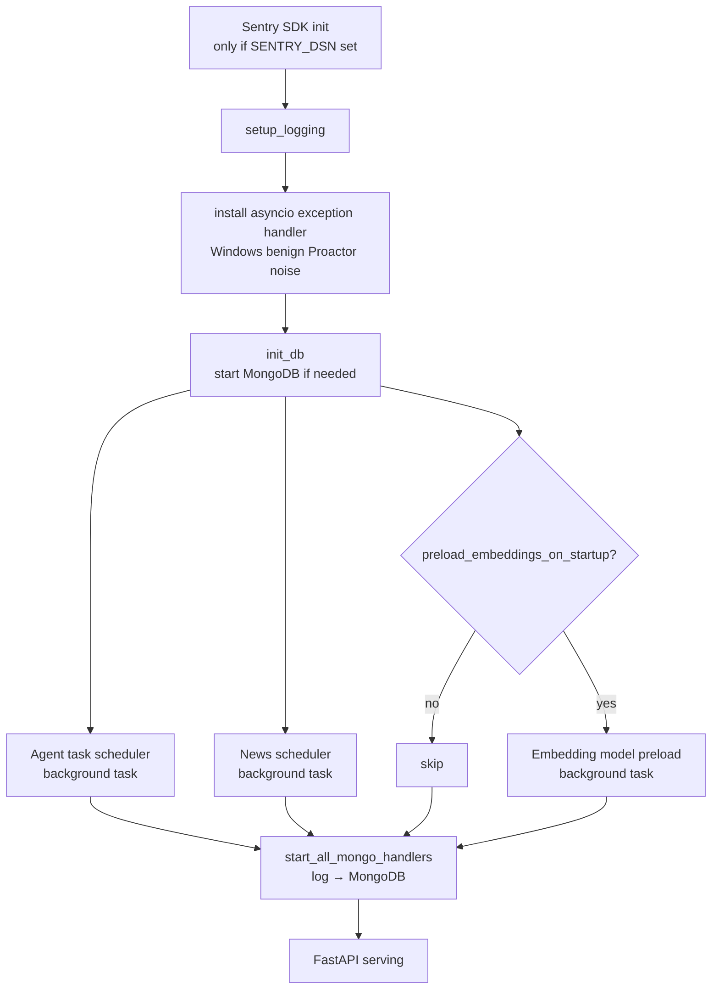

# Background Service Startup

> What runs at boot, in what order, inside `main.py:lifespan()`.

## Source

- `backend/app/main.py:lifespan` (lines ~190–228)
- `backend/app/agent/task_scheduler.py` — scheduler
- `backend/app/news/scheduler.py` — `NewsScheduler`
- `backend/app/knowledge/embeddings.py` — `preload_model()`

## How it works

## Key facts

- All three heavyweight starts (scheduler, news scheduler, embedding preload) run via
  `_start_background_service()` — they don't block app readiness.
- Embedding preload is **opt-in** via `AppSettings.preload_embeddings_on_startup`.
- On Windows, `WindowsProactorEventLoopPolicy` is set at module level (defense in depth).
- Shutdown reverses the order: cancel background tasks → stop news scheduler → stop agent scheduler → stop Mongo log handlers → close DB.

## Depends on

- [[Task Scheduler]]
- [[News Scheduler]]
- [[Local Embeddings]]
- [[App Settings]]
- [[Sentry Setup]]

## Gotchas

- Background task failures are logged via `add_done_callback` — they don't crash the app.
- The known benign Windows error `WinError 10054` during shutdown is suppressed by a custom asyncio exception handler.

## See also

- [[_index]]
- [[Windows Event Loop]]
