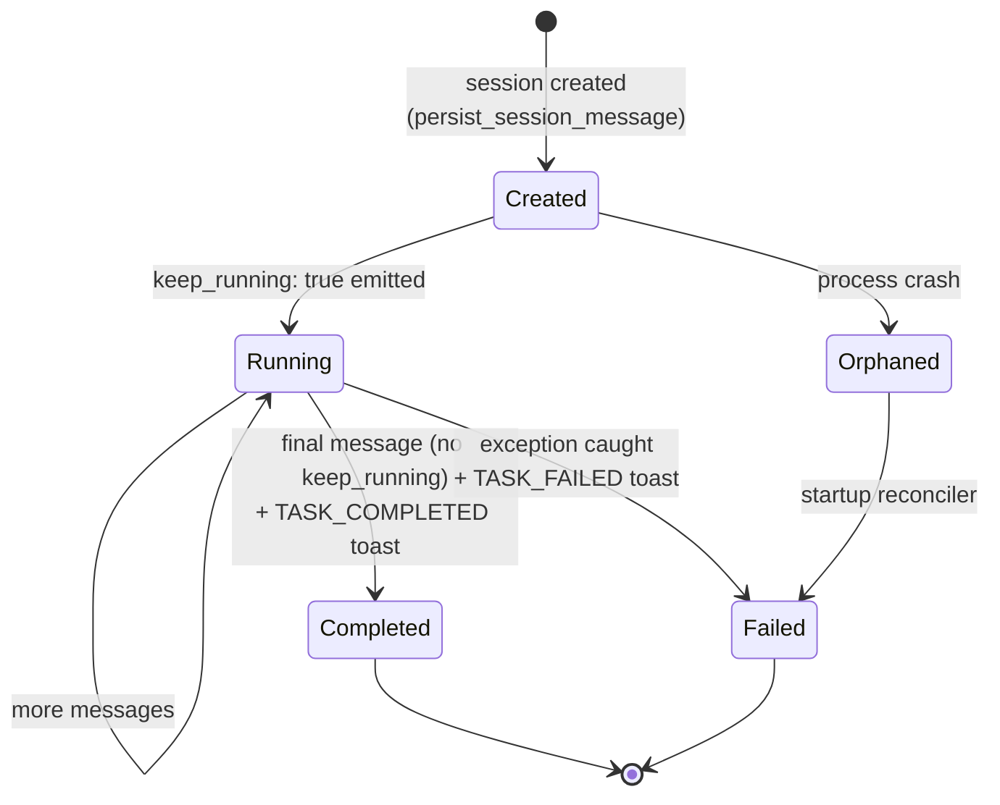

# Chat-Session Lifecycle

> State machine for `AgentSession` rows — created → running → completed / failed.

## Source

- `backend/app/db/models/agent_session.py` — `AgentSession`, `AgentSessionMessage`, helpers
- `backend/app/agent/task_scheduler.py` — `_mark_orphaned_discovery_cycles_failed`
- `backend/app/services/notification_service.py` — completion / failure toasts

## How it works

## Required legs (see [[Chat-Session Checklist]])

1. **Persistence**: every message inserted via `persist_session_message()` or `persist_session_message_doc()`.
2. **Live stream**: WS broadcast with `type: "message"` + outer `session_id`.
3. **Sidebar spinner**: `keep_running: true` on multi-step runs; final message clears it.
4. **In-place updates**: state transitions mutate the doc + emit `message_updated`.
5. **Message id**: REST + WS payloads must carry the DB id (24-char hex).
6. **Suppress hooks**: every `ClaudeAgentOptions(...)` passes `setting-sources: local`.
7. **Completion toast**: `TASK_COMPLETED` / `TASK_FAILED` with `session_id`.
8. **Failure visibility**: try/except flips running → failed; startup hook for orphans.
9. **UI surfaces**: spinner + click-through navigates to `/agent` with `setSelectedSessionId(id)`.
10. **Strategy shadow**: if creating `StrategyKnowledge`, also create `Strategy` for a real user.

## Depends on

- [[AgentSession Model]], [[AgentSessionMessage Model]]
- [[persist_session_message Pattern]]
- [[Notification Service]]
- [[WebSocket Connection Manager]]

## Used by

- [[Strategy Auto-Discovery Cycle]]
- [[TradingAgent]]
- All background agents that write session messages

## See also

- [[_index]]
- [[Chat-Session Checklist]] (the pattern checklist)
