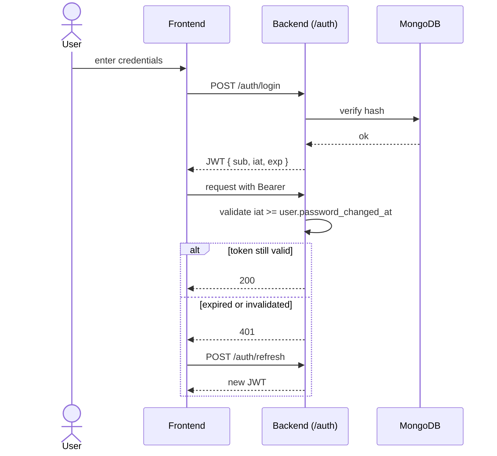

# JWT Auth Flow

> JWT with configurable expiry, transparent refresh, and `iat`-based bulk invalidation.

## Source

- `backend/app/api/v1/auth.py` — login, refresh, change-password
- `backend/app/db/models/user.py` — `password_changed_at` field
- `frontend/src/api/` HTTP client — 401 interceptor

## How it works

## Key rules

- Token expiry: `AppSettings.access_token_expire_minutes` (DB) > `ACCESS_TOKEN_EXPIRE_MINUTES` (env) > 0 (no expiry).
- `POST /auth/refresh` re-issues a token from a valid one (no credentials).
- `POST /auth/change-password` updates `User.password_changed_at` → invalidates **all** prior tokens via the `iat` check.
- Frontend HTTP interceptor auto-calls `/auth/refresh` on 401 before logging the user out.

## Depends on

- [[User Model]] — stores `password_changed_at`
- [[Auth Endpoints]]
- [[HTTP Client Interceptor]] (frontend)

## Used by

- Every authenticated endpoint via `get_current_active_user` dependency
- `get_current_superuser` for admin routes

## Gotchas

- The `iat` invalidation is timestamp-based — ensure server clock is reliable.
- Debug mode (`settings.debug + allow_debug_auth_bypass`) replaces auth with a mock superuser via `dependency_overrides`.

## See also

- [[_index]]
- [[Fernet Encryption]] — secrets at rest
