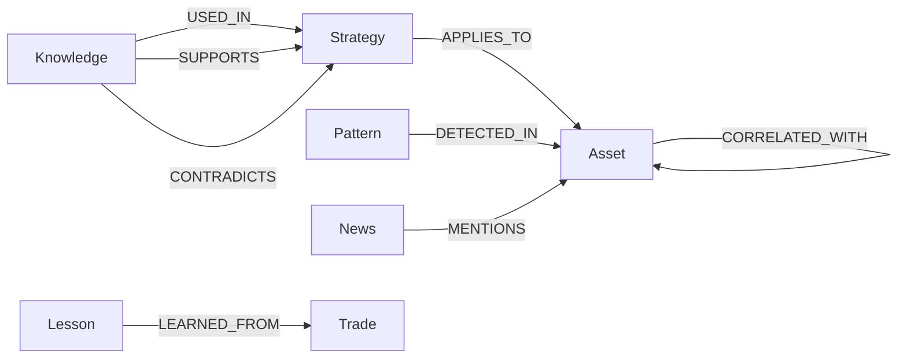

# Knowledge Graph Edges

> Typed relationships between knowledge documents, enabling multi-hop queries.

## Source

- `backend/app/db/models/knowledge_graph.py` — `KnowledgeEdge` model
- `backend/app/knowledge/graph.py` — edge builder

## Edge types

| Edge | From → To | Example use |
|---|---|---|
| `APPLIES_TO` | Strategy → Asset | "strategies for BTC" |
| `DETECTED_IN` | Pattern → Asset | "BTC head-and-shoulders" |
| `MENTIONS` | News → Asset | News impact analysis |
| `LEARNED_FROM` | Lesson → Trade | Post-mortem lookups |
| `USED_IN` | Knowledge → Strategy | Citation tracking |
| `SUPPORTS` | Knowledge → Strategy | Confirming evidence |
| `CONTRADICTS` | Knowledge → Strategy | Disconfirming evidence |
| `CORRELATED_WITH` | Asset → Asset | Pair-trading discovery |

## How it works

Edges are built incrementally during document creation by [[Knowledge Graph Builder]].
Multi-hop queries chain edges, e.g. *"strategies that APPLIES_TO BTC and have a
LEARNED_FROM Lesson with positive PnL"*.

## Depends on

- [[KnowledgeEdge Model]]
- [[StrategyKnowledge Model]], [[TradingPattern Model]], [[NewsArticle Model]], [[TradeLesson Model]]

## Used by

- [[Knowledge Tools]] — agent queries
- [[RAG Retrieval Pipeline]] — graph-aware retrieval

## See also

- [[_index]]
