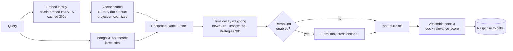

# RAG Retrieval Pipeline

> Hybrid vector + text search with rank fusion, time decay, and optional cross-encoder rerank.

## Source

- `backend/app/knowledge/retriever.py` — main pipeline
- `backend/app/knowledge/embeddings.py` — local nomic-embed-text-v1.5
- `backend/app/knowledge/fusion.py` — Reciprocal Rank Fusion (RRF)
- `backend/app/knowledge/reranker.py` — FlashRank cross-encoder
- `backend/app/knowledge/context_generator.py` — write-time context prefix

## How it works

**Key design**: Motor projection loads only `_id` + `embedding` first; NumPy matrix
multiplication scores all docs at once before fetching only the top-k full documents.
Each search method runs hybrid (vector + text) in parallel, then merges via [[Reciprocal Rank Fusion]].

## Depends on

- [[Local Embeddings]] — query and document embedding
- [[Embedding Cache]] — 300-second TTL
- [[Hybrid Retriever]] — orchestrator
- [[Reciprocal Rank Fusion]]
- [[Time Decay Weighting]]
- [[FlashRank Reranker]] (optional, gated by `AppSettings.reranking_enabled`)
- [[Context Generator]] (write-time)

## Used by

- [[Knowledge Tools]] — agent-side retrieval
- [[News Tools]]
- [[Knowledge Endpoints]] — REST

## Gotchas

- All search methods return `list[tuple[Document, float]]` — every consumer must unpack.
- Time decay half-lives vary per collection; see [[Time Decay Weighting]].
- Embeddings prepend the `context_prefix` field automatically.

## See also

- [[_index]]
- [[Knowledge Graph Edges]]
