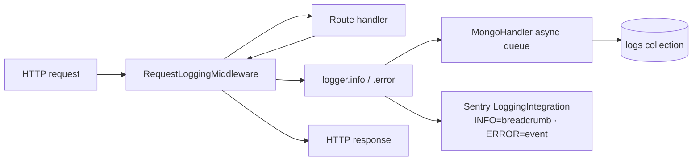

# Request Logging Pipeline

> Async middleware → in-memory queue → MongoDB → Sentry breadcrumbs.

## Source

- `backend/app/middleware/request_logging.py` — `RequestLoggingMiddleware`
- `backend/app/logging_config.py` — `setup_logging`, `start_all_mongo_handlers`
- `backend/app/db/models/log.py` — `LogRecord`

## How it works

Per-request: middleware records start time, method, path, status code, duration in ms.
Logs flow through the standard `logging` module with two handlers attached:

1. **MongoHandler** — async queue + batch writer to the `logs` collection.
2. **Sentry LoggingIntegration** — INFO+ become breadcrumbs, ERROR+ become events.

## Key constraints

- `start_all_mongo_handlers()` is called from `lifespan()` after `init_db()`.
- Mongo writes are batched + non-blocking — never inline in the request path.
- The `/api/v1/logs/frontend` and `/health` transactions are dropped from Sentry by
  `_before_send_transaction` to avoid noise.

## Depends on

- [[LogRecord Model]]
- [[Sentry Backend]] integration
- [[App Settings]] (`debug`, `sentry_dsn`)

## Used by

- All endpoints (transparent via middleware)
- [[Admin Endpoints]] → `/admin/logs` reads from this collection

## Gotchas

- PII scrubbing happens in `_before_send` (Sentry) — bearer tokens, API keys, passwords are redacted.
- The frontend pushes its own logs via `/api/v1/logs/frontend` — see [[Frontend Logger]].

## See also

- [[_index]]
- [[MongoDB MCP Queries]] — how to inspect the `logs` collection in prod
