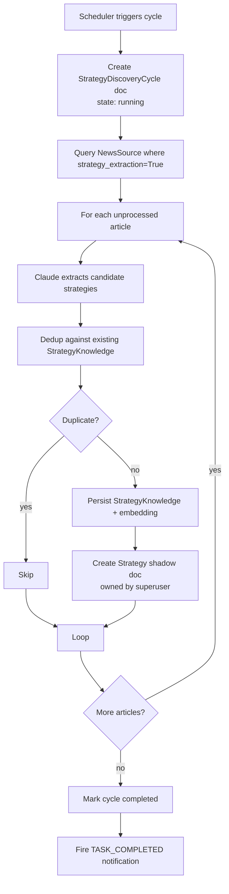

# Strategy Auto-Discovery Cycle

> Scheduled crawl of news sources → AI extraction → dedup → `StrategyKnowledge`.

## Source

- `backend/app/services/strategy_discovery.py` — orchestrator
- `backend/app/services/strategy_extractor.py` — AI extraction (Claude)
- `backend/app/services/strategy_dedup.py` — semantic dedup
- `backend/app/agent/task_scheduler.py` — schedule trigger
- `backend/app/db/models/strategy_discovery_cycle.py` — cycle state

## How it works

## Key rules

- **Strategy shadow doc**: every `StrategyKnowledge` must have a matching `Strategy` doc
  owned by a real user, otherwise the Strategies page can't render it. The scheduler
  resolves a superuser first — `user_id=None` silently skips the shadow.
- **Failure visibility**: try/except wraps the cycle body and flips any "running" row to
  failed. Startup hook reconciles orphans from previous crashes (see
  [[Startup Reconciler]] / `_mark_orphaned_discovery_cycles_failed`).
- Config lives in `AppSettings` (`auto_discover_*`).

## Depends on

- [[StrategyExtractor]] (service)
- [[Strategy Dedup]]
- [[StrategyKnowledge Model]], [[Strategy Model]], [[StrategyDiscoveryCycle Model]]
- [[Task Scheduler]]
- [[Notification Service]]

## Used by

- [[Strategy Discovery Admin Endpoints]]
- [[Strategies Routes]] (frontend) — reads `Strategy` shadow docs

## Gotchas

- See [[Chat-Session Checklist]] — this cycle creates session messages and must satisfy every leg.
- Scheduler paths must resolve a real superuser; never default `user_id=None`.

## See also

- [[_index]]
- [[Chat-Session Checklist]]
