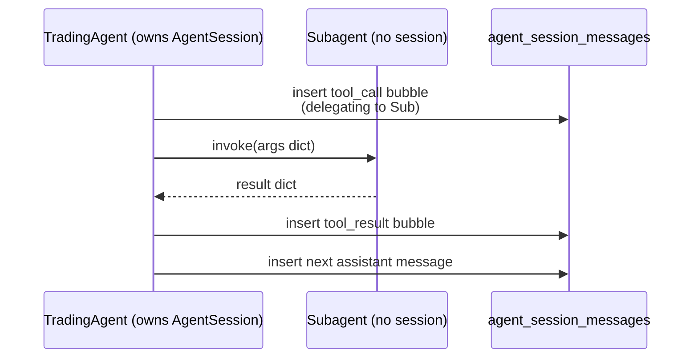

# Subagent Delegation Pattern

> Subagents are pure compute — they receive dicts, return dicts, and never own their own `AgentSession`.

## Source

- `backend/app/agent/trading_agent.py` — parent orchestrator
- `backend/app/agent/subagents/technical_analyst.py` etc. — reference implementations
- `.claude/rules/code-guide.md` (Chat-Session Features section)

## How it works

The parent session's timeline captures everything via tool-call bubbles. Creating a
session per subagent would clutter the sidebar and break the existing pattern.

## The contract

- Subagents are **functions / classes that return dicts**, not `ClaudeSDKClient` users.
- Subagents do NOT call [[persist_session_message Pattern]].
- The parent records the delegation as a tool call (input args) and tool result (output dict).
- All `ClaudeAgentOptions(...)` calls in the parent must pass `extra_args={"setting-sources": "local"}` to suppress the user-level Stop hook (see [[setting-sources local Pattern]]).

## Don't

- Don't create an `AgentSession` inside a subagent.
- Don't call `NotificationService.create_notification` from a subagent — only the parent finishes the cycle.
- Don't omit `extra_args={"setting-sources": "local"}` — every subagent turn would fire a desktop toast otherwise.

## Used by

- [[Trading Decision Flow]]
- [[TechnicalAnalyst]], [[NewsAnalyst]], [[FundamentalAnalyst]], [[RiskManager]]
- [[StrategyExtractor Agent]], [[OrderExecutor]]

## See also

- [[_index]]
- [[Chat-Session Checklist]]
