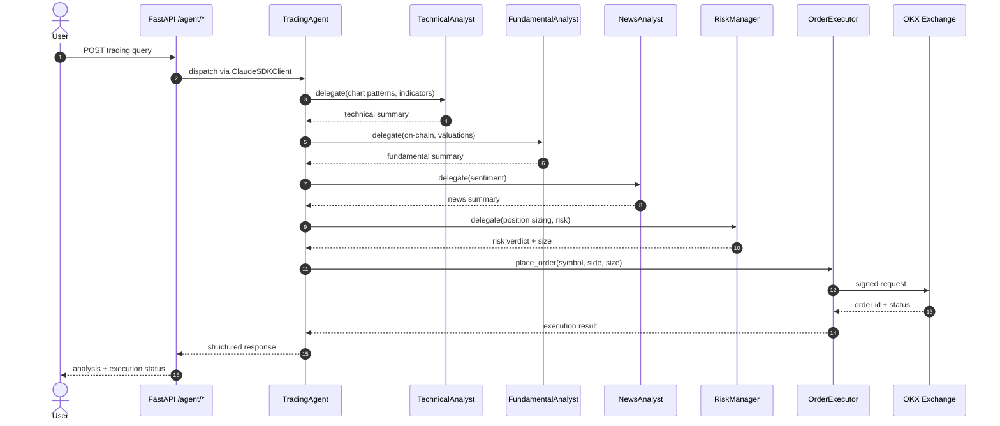

# Trading Decision Flow

> End-to-end sequence from a user request to an executed order on OKX.

## Source

- `backend/app/agent/trading_agent.py` — main orchestrator
- `backend/app/agent/subagents/` — TechnicalAnalyst, FundamentalAnalyst, NewsAnalyst, RiskManager
- `backend/app/agent/subagents/order_executor.py` — risk-gated order placement

## How it works

Each subagent is **pure compute** — receives a dict, returns a dict, owns no
`AgentSession`. The parent session captures the timeline via tool-call bubbles. See
[[Subagent Delegation Pattern]] for the contract.

## Depends on

- [[TradingAgent]] — orchestrator
- [[ClaudeSDKClient Wrapper]] — driver
- [[TechnicalAnalyst]], [[FundamentalAnalyst]], [[NewsAnalyst]], [[RiskManager]]
- [[OrderExecutor]]
- [[OKX Exchange]] (integration)

## Used by

- [[Agent Sessions Endpoints]] (REST entry point)
- [[Agent WS Channel]] (streaming variant)

## Gotchas

- Risk-gated: if [[RiskManager]] vetoes, [[OrderExecutor]] never fires.
- All subagent calls happen inside the parent session — orphaned subagent sessions are a bug.

## See also

- [[_index]]
- [[RAG Retrieval Pipeline]] — knowledge tools enrich subagent reasoning
- [[Chat-Session Checklist]] — every leg required when persisting this flow
